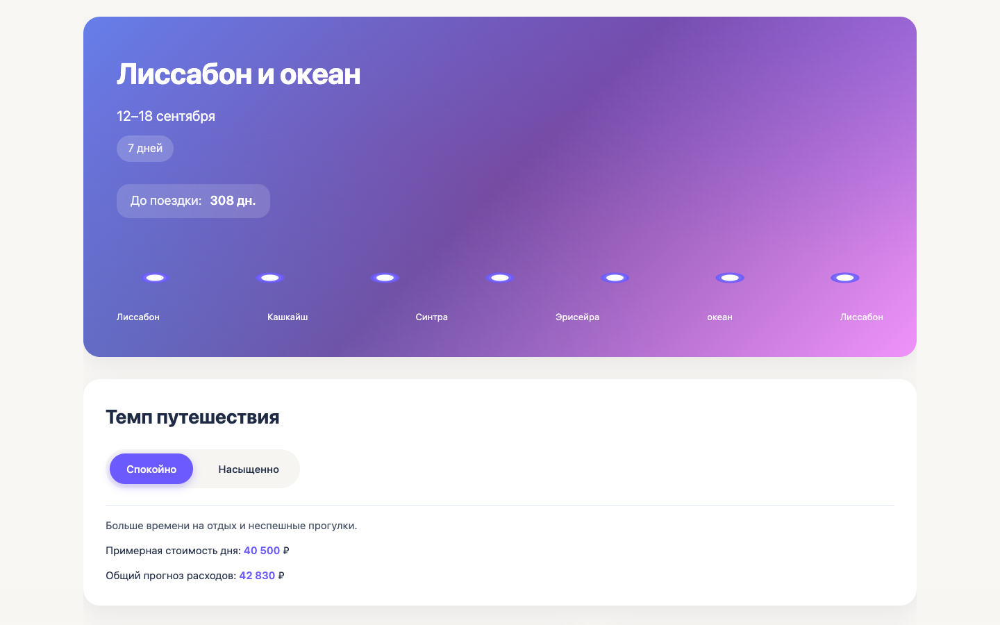
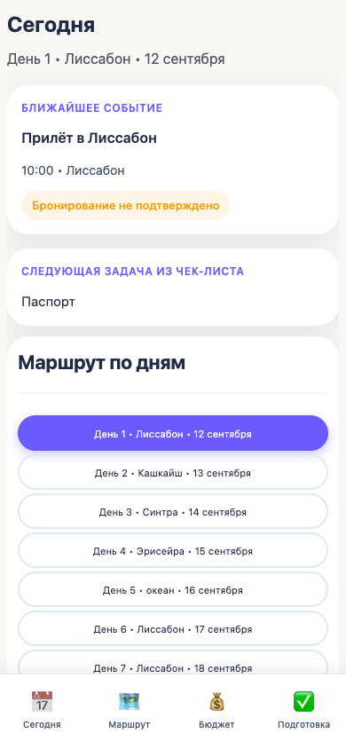
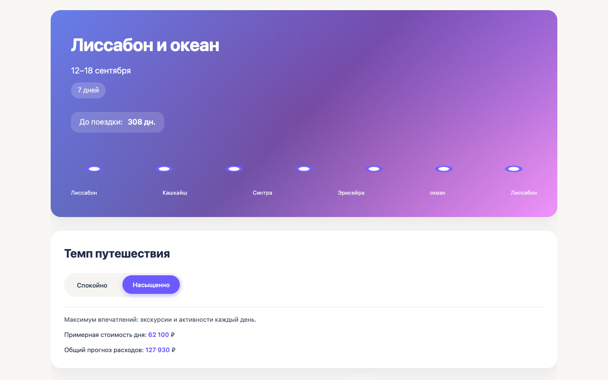
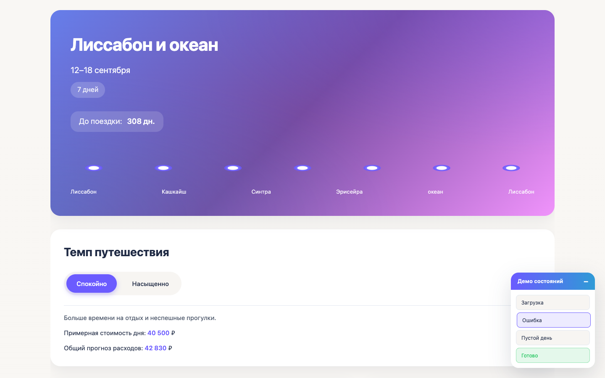
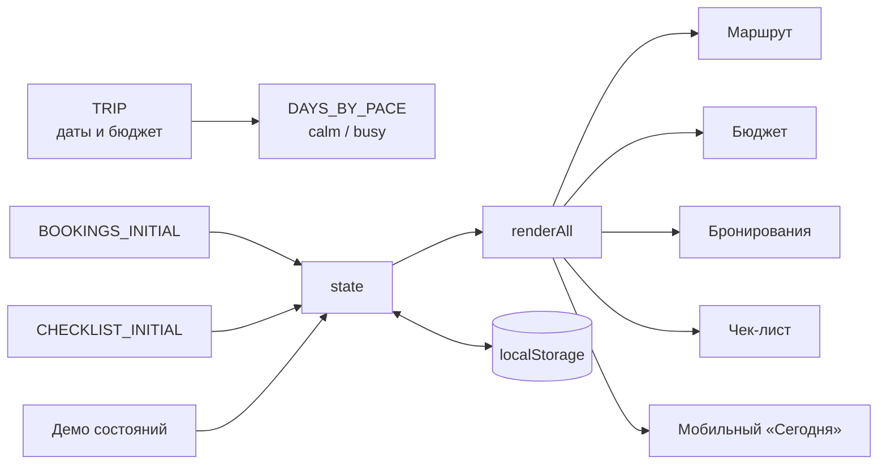
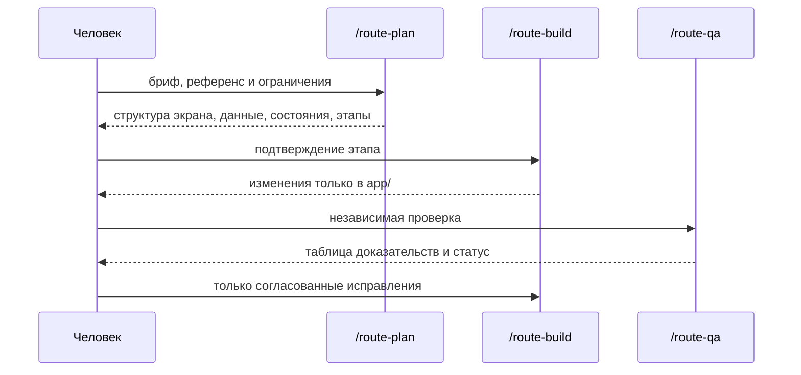

[](https://github.com/elstar883/lisbon-ocean-route-planner/actions/workflows/tests.yml)
[](LICENSE)
[](app/index.html)
[](app/styles.css)
[](app/app.js)
[](package.json)
[](AGENTS.md)

# Маршрут — Лиссабон и океан

Адаптивное приложение для подготовки к поездке: маршрут по дням, темп
путешествия, бюджет, бронирования, чек-лист и мобильный экран «Сегодня».

Проект собран по визуальному референсу на чистых HTML, CSS и JavaScript. Он не
использует фреймворки, сборщики, внешние библиотеки, API и сетевые запросы.
Бронирования, чек-лист и выбранный темп сохраняются в `localStorage` браузера.



---

## Содержание

- [Проблема](#проблема)
- [Что умеет приложение](#что-умеет-приложение)
- [Быстрый старт](#быстрый-старт)
- [Скриншоты](#скриншоты)
- [Как это устроено](#как-это-устроено)
- [Демонстрационная поездка](#демонстрационная-поездка)
- [Состояние и localStorage](#состояние-и-localstorage)
- [Состояния интерфейса](#состояния-интерфейса)
- [Workflow OpenCode](#workflow-opencode)
- [Проверки и CI](#проверки-и-ci)
- [Структура проекта](#структура-проекта)
- [Стек](#стек)
- [Доступность и адаптивность](#доступность-и-адаптивность)
- [Ограничения](#ограничения)
- [Дорожная карта](#дорожная-карта)
- [Лицензия](#лицензия)

---

## Проблема

Перед поездкой информация обычно разбросана: даты и города — в заметках,
бронирования — в письмах, бюджет — в таблице, а чек-лист — в голове. На
маленьком экране хочется сразу видеть ближайшее событие и следующую задачу, а не
прокручивать длинную страницу.

**Решение:** один статический экран, который собирает маршрут, темп, бюджет,
бронирования и подготовку в единый визуальный сценарий. На узком экране
включается режим «Сегодня» с ближайшим событием и следующей задачей.

## Что умеет приложение

### Обложка поездки

- название «Лиссабон и океан»;
- даты 12–18 сентября и продолжительность 7 дней;
- обратный отсчёт до следующего наступления даты поездки;
- декоративная линия маршрута из встроенного SVG.

Обложка полностью построена на CSS-градиентах и SVG: внешних изображений нет.

### Темп путешествия

Переключатель «Спокойно / Насыщенно» меняет:

- набор событий в каждом дне;
- примерную стоимость выбранного дня;
- текстовую подсказку;
- общий прогноз расходов;
- запланированную сумму бюджета и распределение по категориям.

| Темп | Событий за 7 дней | Стоимость дня 1 | Прогноз | Запланировано |
|---|---:|---:|---:|---:|
| Спокойно | 17 | 40 500 ₽ | 42 830 ₽ | 162 000 ₽ |
| Насыщенно | 28 | 62 100 ₽ | 127 930 ₽ | 207 000 ₽ |

### Маршрут по дням

Семь вкладок: Лиссабон → Кашкайш → Синтра → Эрисейра → океан → Лиссабон →
Лиссабон. Для выбранного дня видны город, дата, время, название события,
категория, стоимость и статус бронирования.

### Бюджет

- общий бюджет 180 000 ₽;
- запланированная сумма;
- остаток;
- линейный прогресс;
- шесть категорий расходов.

### Бронирования

Четыре карточки: перелёт, отель, поезд/трансфер и экскурсия. Неподтверждённое
бронирование можно подтвердить кнопкой; статус сохраняется, а на экране
появляется уведомление.

### Чек-лист подготовки

Десять задач в категориях «Документы», «Деньги», «Вещи» и «Здоровье». Отметки
сохраняются в `localStorage`, прогресс пересчитывается сразу. Кнопка «Сбросить
учебные данные» возвращает бронирования, чек-лист и темп к исходному состоянию.

### Мобильный режим «Сегодня»

На ширине до 600 px обложка и панель темпа скрываются, а первым блоком
показывается:

- выбранный день маршрута;
- ближайшее событие, время и город;
- статус бронирования;
- следующая невыполненная задача чек-листа.

Нижняя навигация «Сегодня / Маршрут / Бюджет / Подготовка» прокручивает к
нужному разделу и показывает активный пункт.

### Демо состояний

Сворачиваемая панель в правом нижнем углу переключает `loading`, `error`,
`empty` и `success`. Состояние `error` содержит рабочую кнопку «Повторить»,
`loading` показывает скелетоны, `empty` объясняет пустой день.

### Локальность

- нет backend, базы данных и API;
- нет фреймворков, сборщиков и runtime-зависимостей;
- нет внешних шрифтов, картинок, CDN и аналитики;
- приложение работает после открытия `app/index.html` или через локальный
  статический сервер.

## Быстрый старт

Нужен современный браузер. Node.js и Python понадобятся только для проверок и
локального статического сервера.

```bash
git clone https://github.com/elstar883/lisbon-ocean-route-planner.git
cd lisbon-ocean-route-planner

make serve
# или:
python3 -m http.server 8080 --directory app
```

Откройте <http://127.0.0.1:8080>.

Приложение не использует ES-модули и IndexedDB, поэтому обычное открытие
`app/index.html` через `file://` тоже работает. Локальный сервер нужен только для
удобства и единообразия проверок.

### Проверка структуры и кода

```bash
make check
# или:
node scripts/validate.mjs
node --check app/app.js
```

Скрипт проверяет обязательные файлы, метаданные репозитория, разметку, стили,
данные демонстрационной поездки, ключевые сценарии, отсутствие сетевых вызовов и
синтаксис приложения.

## Скриншоты

| Десктоп | Мобильная версия |
|---|---|
|  |  |

Полные страницы: [desktop 1440 px](docs/images/route-desktop.png) ·
[mobile 390 px](docs/images/route-mobile.png).

### Режим «Насыщенно»



### Демо состояний



## Как это устроено



1. `TRIP`, `PACE_CONFIG`, `DAYS_BY_PACE`, `BOOKINGS_INITIAL`,
   `CHECKLIST_INITIAL` и `BUDGET_CATEGORIES_BASE` задают демонстрационные данные.
2. `initFromStorage()` восстанавливает бронирования, чек-лист и темп из
   `localStorage`.
3. `renderAll()` последовательно обновляет вкладки, события, темп, бюджет,
   бронирования, чек-лист и мобильный экран.
4. Каждое действие сначала меняет объект `state`, затем сохраняет нужную часть в
   `localStorage` и только после этого перерисовывает интерфейс.
5. `state.uiState` управляет состояниями `loading`, `error`, `empty` и `success`.

Подробнее — в [docs/ARCHITECTURE.md](docs/ARCHITECTURE.md).

### Почему без фреймворка

Приложение состоит из одного экрана и локального состояния. Vanilla JavaScript
позволяет показать работу с DOM, событиями, адаптивом, SVG и `localStorage` без
лишнего слоя зависимостей. Нет пакетов — нет обновлений, уязвимостей и сюрпризов
при запуске. Node.js используется только для проверок и CI.

## Демонстрационная поездка

Все даты, суммы, адреса и бронирования синтетические.

### Маршрут

| День | Город | Дата | Событий «Спокойно» | Событий «Насыщенно» |
|---:|---|---|---:|---:|
| 1 | Лиссабон | 12 сентября | 3 | 4 |
| 2 | Кашкайш | 13 сентября | 3 | 4 |
| 3 | Синтра | 14 сентября | 2 | 4 |
| 4 | Эрисейра | 15 сентября | 2 | 4 |
| 5 | океан | 16 сентября | 2 | 4 |
| 6 | Лиссабон | 17 сентября | 2 | 4 |
| 7 | Лиссабон | 18 сентября | 3 | 4 |
| **Итого** | | | **17** | **28** |

### Бюджет

| Категория | База | Спокойно (×0,9) | Насыщенно (×1,15) |
|---|---:|---:|---:|
| Перелёт | 25 000 ₽ | 22 500 ₽ | 28 750 ₽ |
| Отель | 80 000 ₽ | 72 000 ₽ | 92 000 ₽ |
| Транспорт | 15 000 ₽ | 13 500 ₽ | 17 250 ₽ |
| Экскурсии | 20 000 ₽ | 18 000 ₽ | 23 000 ₽ |
| Питание | 25 000 ₽ | 22 500 ₽ | 28 750 ₽ |
| Прочее | 15 000 ₽ | 13 500 ₽ | 17 250 ₽ |
| **Итого** | **180 000 ₽** | **162 000 ₽** | **207 000 ₽** |

### Бронирования и чек-лист

- 4 бронирования: 1 подтверждено изначально, 3 ожидают подтверждения;
- 10 задач чек-листа: 3 документа, 2 денежные задачи, 3 вещи, 2 задачи здоровья.

Подробнее — в [docs/DATA-MODEL.md](docs/DATA-MODEL.md).

## Состояние и localStorage

Приложение использует три ключа:

| Ключ | Что хранит |
|---|---|
| `routePlanner.bookings` | массив бронирований и их статусы |
| `routePlanner.checklist` | отметки чек-листа по категориям |
| `routePlanner.pace` | выбранный темп `calm` или `busy` |

`localStorage` обёрнут в `try/catch`: если браузер запрещает хранение,
приложение продолжает работать в памяти без падения.

Кнопка «Сбросить учебные данные» возвращает исходные бронирования, чек-лист и
темп, затем сохраняет их обратно.

## Состояния интерфейса

| Состояние | Что показывает |
|---|---|
| `loading` | скелетоны заголовка, строк и карточек |
| `error` | сообщение об ошибке и кнопку «Повторить» |
| `empty` | объяснение пустого дня и подсказку выбрать другой день |
| `success` | обычный список событий |

Состояния переключаются панелью «Демо состояний»; кнопка «Повторить»
возвращает `success`.

## Workflow OpenCode

Проект собран воспроизводимым процессом с разделением ролей:



- **`/route-plan`** — проектирует экран и сценарии, не меняя файлы.
- **`/route-build`** — реализует подтверждённый этап только внутри `app/`.
- **`/route-qa`** — проверяет приложение по критериям и ничего не исправляет.

Методика описана в
[`.opencode/skills/lisbon-ocean-route-planner/SKILL.md`](.opencode/skills/lisbon-ocean-route-planner/SKILL.md),
правила проекта — в [`AGENTS.md`](AGENTS.md).

## Проверки и CI

```bash
make check
```

`scripts/validate.mjs` проверяет:

- обязательные файлы и метаданные репозитория;
- отсутствие архивов, `.DS_Store`, `.env` и PDF в публикуемом наборе;
- данные поездки: 7 дней, 17 событий «Спокойно», 28 событий «Насыщенно»;
- 4 бронирования, 10 задач чек-листа и 6 категорий бюджета;
- обязательные элементы интерфейса и демо-состояния;
- использование `localStorage` для бронирований, чек-листа и темпа;
- отсутствие `fetch`, `XMLHttpRequest`, WebSocket и внешних ресурсов;
- локальные ссылки на скриншоты;
- синтаксис `app/app.js`.

GitHub Actions прогоняет те же проверки на Node.js 18, 20 и 22 при push в
`main`/`develop` и на pull request.

Ручной сценарий — в [docs/QA-CHECKLIST.md](docs/QA-CHECKLIST.md).

## Структура проекта

```text
lisbon-ocean-route-planner/
├── app/                              # статическое приложение
│   ├── index.html                    # разметка экрана
│   ├── styles.css                    # оформление, состояния, адаптив
│   └── app.js                        # данные, состояние и рендеринг
├── references/
│   ├── design-brief.md               # исходный бриф
│   ├── acceptance-checklist.md       # критерии готовности
│   └── visual-reference.png          # визуальный ориентир
├── docs/
│   ├── ARCHITECTURE.md               # архитектура и поток данных
│   ├── DATA-MODEL.md                 # модель поездки и localStorage
│   ├── QA-CHECKLIST.md               # ручная и автоматическая проверка
│   └── images/                       # скриншоты desktop и mobile
├── .opencode/
│   ├── commands/                     # route-plan, route-build, route-qa
│   └── skills/
│       └── lisbon-ocean-route-planner/
│           └── SKILL.md              # повторяемая методика
├── scripts/
│   └── validate.mjs                  # проверка структуры и ограничений
├── .github/workflows/tests.yml       # CI
├── AGENTS.md                         # правила проекта
├── CONTRIBUTING.md                   # ветки, коммиты, PR-процесс
├── LICENSE                           # MIT
├── Makefile                          # make check / make serve
├── package.json                      # только скрипты, без зависимостей
├── opencode.json                     # разрешения OpenCode
└── README.md
```

## Стек

- **HTML5** — семантическая разметка и встроенный SVG;
- **CSS3** — custom properties, Grid, Flexbox, градиенты, медиазапросы,
  `prefers-reduced-motion`;
- **Vanilla JavaScript** — состояние, DOM API, события, `localStorage`;
- **Node.js 18+** — только для `scripts/validate.mjs` и CI;
- **GitHub Actions** — матрица Node.js 18/20/22;
- **OpenCode** — команды и Skill.

Без фреймворков, сборщиков, пакетов и runtime-зависимостей.

## Доступность и адаптивность

- семантические ориентиры `main`, `section`, `aside`, `nav`;
- подписи у кнопок и чекбоксов;
- видимый фокус и работа с клавиатуры;
- `prefers-reduced-motion` отключает анимации;
- проверено на 1440, 768 и 390 px без горизонтальной прокрутки;
- на мобильном экране главным блоком становится «Сегодня»;
- нижняя навигация использует настоящие кнопки и доступна с клавиатуры.

## Ограничения

- состояние живёт в `localStorage` одного браузера;
- нет аккаунтов, синхронизации и совместной работы;
- нет интеграции с реальными сервисами бронирования;
- данные демонстрационные и не являются реальным маршрутом;
- приложение не отправляет данные и не собирает аналитику;
- панель «Демо состояний» предназначена для показа, а не для продакшена.

## Дорожная карта

- [ ] сохранение выбранного дня между перезагрузками;
- [ ] печатная версия маршрута;
- [ ] экспорт маршрута в JSON;
- [ ] настройка бюджета и категорий;
- [ ] покрытие сценариев тестами Playwright;
- [ ] GitHub Pages для живого демо;
- [ ] английская версия интерфейса.

## Лицензия

Проект распространяется по лицензии [MIT](LICENSE).

## Автор

**Elsa** — [@elstar883](https://github.com/elstar883)

Проект собран как портфолио-кейс: от анализа визуального референса и требований
до адаптивного интерфейса, локального состояния, автоматических проверок, CI и
независимой QA-проверки.
