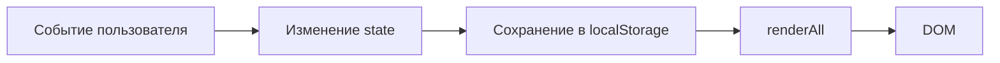

# Архитектура «Маршрут — Лиссабон и океан»

## 1. Общая схема

Приложение статическое. Оно состоит из трёх файлов и не имеет сервера,
сборщика или внешних зависимостей.

```text
app/index.html  →  разметка и контейнеры для динамических блоков
app/styles.css  →  токены, компоненты, состояния и адаптивность
app/app.js      →  данные, состояние, рендеринг и обработчики
```

Поток данных односторонний:



Любое действие сначала меняет объект `state`, затем сохраняет нужную часть в
`localStorage` и только после этого вызывает `renderAll()`.

## 2. Данные

### `TRIP`

Постоянные сведения о поездке:

- название;
- даты начала и окончания;
- количество дней;
- маршрут;
- общий бюджет.

### `PACE_CONFIG`

Настройки двух режимов:

- `calm` — подсказка, множитель стоимости `0.9`, дельта прогноза `-10 000`;
- `busy` — подсказка, множитель стоимости `1.15`, дельта прогноза `+15 000`.

### `DAYS_BY_PACE`

Два независимых набора по 7 дней. Каждый день содержит город, дату и массив
событий. Событие ссылается на бронирование через `bookingRef` или имеет
`bookingRef: null`.

### `BOOKINGS_INITIAL`, `CHECKLIST_INITIAL`, `BUDGET_CATEGORIES_BASE`

Исходные бронирования, задачи чек-листа и категории бюджета. Они копируются в
`state` при запуске, чтобы сброс возвращал исходные значения.

## 3. Состояние

```js
let state = {
  pace: "calm",
  activeDayIndex: 0,
  bookings: [...],
  checklist: {...},
  uiState: "success"
};
```

- `pace` — выбранный темп;
- `activeDayIndex` — индекс выбранного дня;
- `bookings` — текущие статусы бронирований;
- `checklist` — отметки задач;
- `uiState` — `loading`, `error`, `empty` или `success`.

## 4. Рендеринг

`renderAll()` вызывает по порядку:

1. `renderDaysTabs()` — вкладки дней;
2. `renderEvents()` — события выбранного дня и состояние маршрута;
3. `renderPace()` — подсказка, стоимость дня и прогноз;
4. `renderBudget()` — сумма, остаток, прогресс и категории;
5. `renderBookings()` — карточки бронирований;
6. `renderChecklist()` — чек-лист и прогресс;
7. `renderMobileToday()` — ближайшее событие и следующая задача.

Каждая функция читает только `state` и общие константы, поэтому повторный вызов
безопасен.

## 5. Локальное хранение

| Ключ | Данные | Когда сохраняется |
|---|---|---|
| `routePlanner.bookings` | бронирования | подтверждение и сброс |
| `routePlanner.checklist` | чек-лист | изменение отметки и сброс |
| `routePlanner.pace` | темп | переключение и сброс |

`initFromStorage()` оборачивает чтение в `try/catch` и проверяет допустимые
значения темпа. Если данные повреждены, приложение использует исходные.

## 6. Состояния интерфейса

`state.uiState` управляет видимостью четырёх блоков:

- `#routeLoading` — скелетоны;
- `#routeError` — сообщение и кнопка `#routeRetryBtn`;
- `#routeEmpty` — объяснение пустого дня;
- `#routeContent` — обычный список.

Кнопка «Повторить» возвращает `success`. Панель «Демо состояний» переключает
состояния и не влияет на сохранённые данные.

## 7. Мобильный режим

На ширине до 600 px:

- обложка и панель темпа скрываются;
- блок `.mobile-today` становится первым;
- показывается нижняя навигация `.bottom-nav`;
- `renderMobileToday()` выбирает событие выбранного дня и следующую
  невыполненную задачу.

Если выбранный день совпадает с сегодняшней датой, берётся ближайшее по времени
событие. Иначе показывается первое событие дня.

## 8. Обратный отсчёт

Даты поездки не привязаны к конкретному году. `updateCountdown()` вычисляет
ближайшее наступление 12 сентября и показывает количество дней до него. Таймер
обновляется раз в минуту.

## 9. Ограничения архитектуры

- нет маршрутизации и отдельных страниц;
- нет серверной валидации;
- нет синхронизации между браузерами;
- `localStorage` ограничен размером и может быть очищен пользователем;
- данные не являются реальным бронированием или платёжной информацией.
